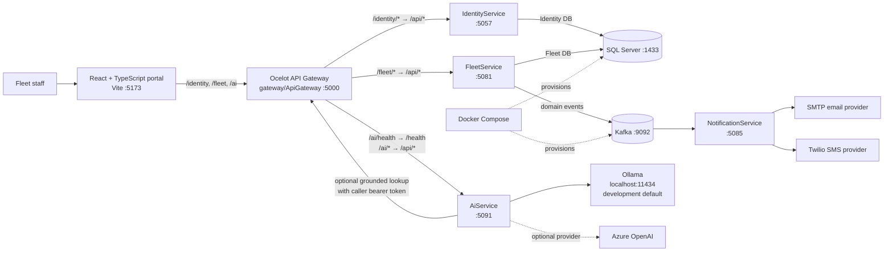

# Smart Fleet Platform — Project Context Graph

> **Purpose:** Give an AI assistant or developer a reliable starting point for understanding the repository, its current implementation, and what is still unverified. Read this before making cross-cutting changes.

**Snapshot prepared:** 2026-10-20  
**Latest project status recorded in the repository:** 2026-10-20 in [Tracker.md](./Tracker.md)
**Status caveat:** This is a repository and documentation snapshot, not a live health check. Services and tests were not run while preparing this file.

## Project in one sentence

Smart Fleet Platform is a local-development, microservices-based fleet management application: a React/TypeScript portal calls .NET services through an Ocelot gateway; Fleet and Identity persist to SQL Server, Fleet publishes Kafka events, a Notification service consumes events, and an AI service can use local Ollama or configured Azure OpenAI while grounding some answers in live fleet records.

## System graph



### Request and dependency flow

1. In development, Vite proxies `/identity`, `/fleet`, and `/ai` requests to the gateway at `http://localhost:5000`.
2. `gateway/ApiGateway/ocelot.json` maps those prefixes to Identity (`5057`), Fleet (`5081`), and AI (`5091`). The AI health path is a special mapping to `/health`; other AI paths map to `/api/...`.
3. Identity issues JWTs and stores user accounts. The portal attaches its saved bearer token to API requests.
4. Fleet validates JWTs, applies role policies, and executes fleet operations against its SQL Server database. Its application layer uses MediatR for CQRS features; services/repositories and EF Core live in the infrastructure layer.
5. Fleet publishes domain events to Kafka. NotificationService consumes notification-related events and dispatches through configured providers.
6. AI can forward the caller's bearer token to the gateway to look up a matching registered vehicle and related fleet records, then include that context in a model request.

## Implemented capabilities

| Area | Current implementation evidenced in source |
|---|---|
| Identity and access | Registration, login, JWT authentication, stored user roles, Admin/SuperAdmin user and role management, and bootstrap-admin configuration. New public registrations are assigned `Dispatcher`. Password handling uses ASP.NET Core `PasswordHasher`; legacy SHA-256 hashes are upgraded after successful login, according to the latest tracker entry. |
| Fleet operations | Authenticated APIs for vehicles, drivers, maintenance records, fuel records, dashboard stats, and trips. Vehicle-driver assignment/history and an Admin-only vehicle status/incident workflow are also present. The Fuel Dashboard shows completed-trip distance and fuel consumption separately from refueling records and spend. |
| Trip lifecycle | APIs support scheduling, starting, completing, and cancelling trips. Tracker records lifecycle and role-policy tests; live database/event integration is not fully verified. |
| Authorization | Fleet write operations have role policies. Roles in source include `Admin`, `SuperAdmin`, `FleetManager`, `Dispatcher`, `MaintenanceTechnician`, `SafetyOfficer`, `Viewer`, and `Driver`. Frontend gating exists for user management and some Admin actions; comprehensive UI role gating remains work in progress. |
| AI | Authenticated chat and fleet-health endpoints; Ollama is the development default (`qwen3:0.6b`), Azure OpenAI is optional. The assistant can prepare role-aware structured drafts for trips, maintenance, fuel logs, vehicle status changes, and driver assignments. Users review and confirm each draft in the portal, which calls existing Fleet APIs with the user's JWT; Fleet remains the final authorization and validation boundary. AI context lookup supports registration numbers and manufacturer/model status queries, and can include related maintenance and fuel history. |
| Notifications | Kafka consumer and dispatcher with SMTP and Twilio sender implementations. Provider configuration is validated during service startup; real provider credentials/configuration are required for delivery. |
| Portal | Login/register, dashboard, vehicle and driver list/detail, maintenance, fuel, AI assistant, profile, and Admin user management pages. Signed-out visits to `/` route directly to `/login`; signed-in users route to their dashboard. The AI assistant supports editable action drafts with explicit per-action confirmation; action controls follow the frontend role matrix. APIs are centralized in `src/api`. There is no trip-management page/route in the current portal route table. |
| Local infrastructure | Docker Compose provisions SQL Server 2022, Kafka, and ZooKeeper (plus Kafka UI). `run-all.ps1` starts the infrastructure and the services/portal for local development. |
| Automation | A scheduled/manual GitHub Actions workflow runs the PowerShell E2E smoke script against a configured target. |

## Code map

```text
frontend/fleet-portal/                 React/Vite portal
  src/App.tsx                          Route table and authenticated layout
  src/features/                        Feature pages (auth, dashboard, vehicles, drivers, etc.)
  src/api/                             Shared Axios client and typed service APIs
  src/store.ts                         Redux Toolkit state

gateway/ApiGateway/                    Gateway launched by run-all.ps1; Ocelot routes
gateway/SmartFleet.Gateway/            Separate Ocelot project; not the launcher-selected gateway
services/identity-service/
  IdentityService.API/                 Identity API, EF Core context, migrations, auth and role logic
services/fleet-service/
  FleetService.API/                    Fleet controllers, auth setup, middleware, database startup
  FleetService.Application/             DTOs, CQRS features/handlers/validators, service contracts
  FleetService.Domain/                  Fleet entities and domain behavior
  FleetService.Infrastructure/          EF Core, repositories, Kafka, and fleet services
  FleetService.Tests/                   Authorization and trip lifecycle tests
services/ai-service/
  AiService.API/                        AI endpoints and health endpoints
  AiService.Application/                AI contracts, handlers, and DTOs
  AiService.Domain/                      AI domain project
  AiService.Infrastructure/              Ollama/Azure providers and fleet context client
  AiService.Tests/                       AI provider and configuration tests
services/notification-service/
  NotificationService.API/              Health/API and Kafka consumer host
  NotificationService.Domain/            Notification sender contracts and event types
  NotificationService.Infrastructure/    Kafka, dispatch, SMTP, and Twilio implementations
  NotificationService.Tests/             Notification unit/integration test scaffold
scripts/e2e/                             Configurable PowerShell smoke runner
docs/MarkDowns/                          Product, architecture, schema, rules, and status documentation
docs/UIUX-Design/                        UI design references and exported assets
```

### Which gateway should be edited?

The default launcher starts `gateway/ApiGateway`. Its Ocelot configuration is the one used by the documented local portal URLs. There are other gateway project/config copies (`gateway/SmartFleet.Gateway` and `services/ApiGateway`); inspect solution membership and launch configuration before changing one of these alternatives.

## Local development entry points

| Component | Local address | Notes |
|---|---|---|
| Portal | `http://localhost:5173` | Started with `npm run dev` in `frontend/fleet-portal`. |
| Ocelot gateway | `http://localhost:5000` | Main entry point for portal API calls. |
| Fleet API | `http://localhost:5081/swagger` | Fleet service; authenticated endpoints require a JWT. |
| Identity API | `http://localhost:5057/swagger` | Identity service. |
| AI API | `http://localhost:5091/health` | AI service; development provider configuration is in its Development settings. |
| Notification API | `http://localhost:5085/health` | `run-all.ps1` sets the local URL; notification provider settings are required at startup. |
| SQL Server | `localhost:1433` | Docker Compose local database host. |
| Kafka | `localhost:9092` | Docker Compose local broker address. |
| Kafka UI | `http://localhost:8080` | Docker Compose local UI. |
| Ollama | `http://localhost:11434` | Optional local model server used by the documented AI development setup. |

Typical local startup is `.\run-all.ps1` from the repository root. It is a convenience script, not a health/readiness guarantee. Use [IntegrationTestingGuide.md](./IntegrationTestingGuide.md) for prerequisites, provider configuration, credentials, and checks. Never add real secrets to tracked configuration.

## Current status and open work

The tracker describes the platform as **in progress**, with an 84% headline completion estimate; that percentage is a planning estimate, not a build-derived metric.

### Latest recorded verification (not rerun for this snapshot)

- On 2026-10-20, frontend build and lint passed after adding completed-trip fuel usage to the Fuel Dashboard; the frontend permission suite passed 9/9. The build retained the existing large JavaScript bundle advisory. A read-only live Fleet API check confirmed a completed trip had recorded distance and fuel consumed while its vehicle had no refueling records.
- On 2026-10-20, the AI agent MVP passed frontend build/lint and permission tests (9/9), plus 21 AI service tests. An isolated API using local Ollama returned HTTP 401 without a token, gave a Dispatcher a trip draft, and denied a Viewer a trip draft. No create request was sent during the smoke check. Offline NuGet vulnerability metadata lookup emitted NU1900 warnings; restore used cached packages.
- On 2026-10-20, AI vehicle status lookup was expanded to resolve manufacturer/model phrases; AI service tests passed 23/23, including Honda Unicorn and unknown-model cases. The frontend production build passed with the existing large-chunk advisory.
- FleetService test suite: 38 tests passed after the trip module work; earlier recorded passes include 29 tests after assignment work.
- AI service test suite: 9 tests passed for provider/configuration and fleet-context work; an earlier 5-test configuration-regression run also passed.
- Frontend `npm.cmd run lint` and `npm.cmd run build` passed on 2026-10-18. The production build had an existing large JavaScript bundle advisory.
- Local E2E smoke run passed seven required checks on 2026-10-18, including authenticated fleet and AI-grounding scenarios.
- Tracker reports Identity/Fleet builds and gateway-backed login checks passed. AI generation was tested with local Ollama; Azure OpenAI remains unverified without its configuration.

### Known outstanding verification/work

- Verify signed-role authorization through real HTTP requests and verify Admin incident/work-order persistence and rollback against a database.
- Verify assignment and trip persistence, Kafka event delivery, and broader database/event integration against running infrastructure.
- Add/complete maintenance and fuel detail endpoint integration checks and comprehensive frontend role-based access checks.
- Configure and validate real notification provider credentials/delivery where needed.
- Azure OpenAI use requires endpoint, API key, and deployment configuration; do not assume it is configured.
- Cloud deployment and production readiness are not complete. Real-time GPS, geofencing, reporting/analytics service, mobile app, Redis, and Kubernetes are roadmap items rather than delivered end-to-end features.

For the live work log and dated evidence, consult [Tracker.md](./Tracker.md), not the status sections in older planning documents.

## Documentation precedence and known drift

Repository documents have accumulated over time and do not all describe the same milestone:

1. Use the **current source and configuration** to determine what is implemented.
2. Use the newest dated entries in [Tracker.md](./Tracker.md) for recent progress and verification evidence.
3. Use [TechSpec.md](./TechSpec.md), [PRD.md](./PRD.md), [AppFlow.md](./AppFlow.md), [Schema.md](./Schema.md), [ImplementationPlan.md](./ImplementationPlan.md), [Design.md](./Design.md), and [Rules.md](./Rules.md) for intended architecture, requirements, and standards—not as proof that every feature is complete.
4. The older [IntegrationTestingReport.md](./IntegrationTestingReport.md) records a historical gateway timeout, while newer Tracker entries report gateway routes working. Do not treat the old timeout as current without reproducing it.
5. Some older documents say Trip Management or frontend work is pending; the current Fleet API includes trip lifecycle endpoints, while the portal still has no trip page.
6. Product/technical docs mention multiple AI models and Azure OpenAI. The checked-in development settings instead select local Ollama; Azure is optional.
7. The schema document includes aspirational tables/features beyond the current EF model. For actual Fleet persistence, inspect `FleetDbContext`, entity classes, and migrations.

## Working conventions for future AI assistants

- Read this graph first, then the relevant source and the latest tracker entry; do not assume this snapshot is current after new work lands.
- Follow the repository's Clean Architecture boundaries: API → Application → Domain; Infrastructure implements Application/Domain abstractions. Reuse existing services, repositories, DTOs, validators, and MediatR patterns.
- Keep Fleet authorization consistent with `FleetRoles` and Identity's `UserRoles`; test both allow and deny behavior when changing policies.
- Keep frontend HTTP calls in the shared API modules and keep request/response types aligned with backend DTOs.
- For schema changes, inspect existing migrations and contexts before editing; update migrations and tests with the implementation.
- Update `Tracker.md` when completing a project task, as required by `Rules.md`.
- Distinguish implementation, automated test coverage, live integration verification, and roadmap scope in status statements.

## Related project documents

- [Product requirements](./PRD.md)
- [Technical specification](./TechSpec.md)
- [Application flows](./AppFlow.md)
- [Database schema proposal](./Schema.md)
- [Implementation plan](./ImplementationPlan.md)
- [Development rules](./Rules.md)
- [UI/UX design](./Design.md)
- [Development tracker](./Tracker.md)
- [Integration testing guide](./IntegrationTestingGuide.md)
- [Historical integration test report](./IntegrationTestingReport.md)
